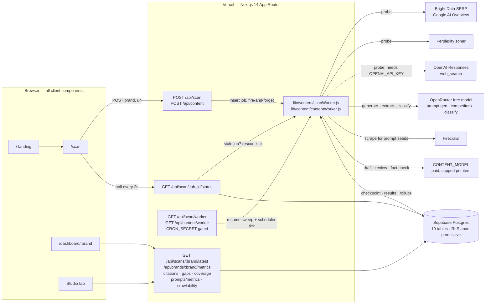
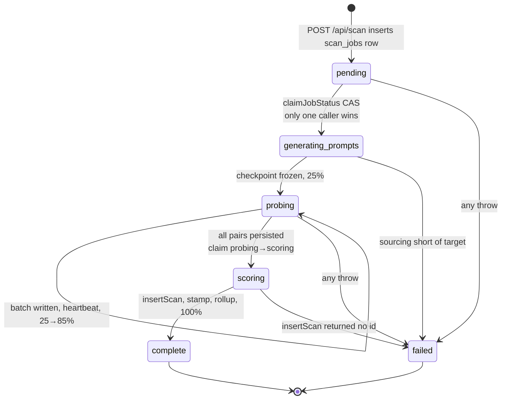
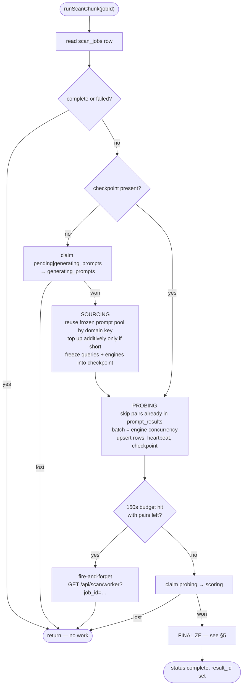
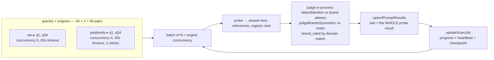
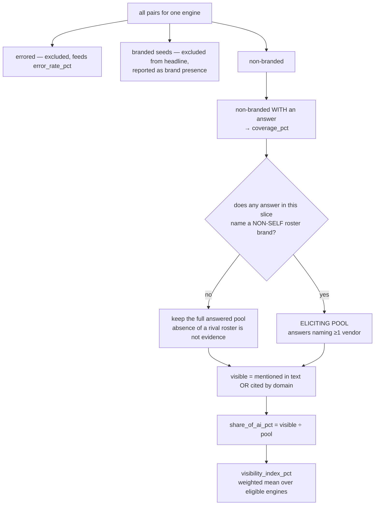
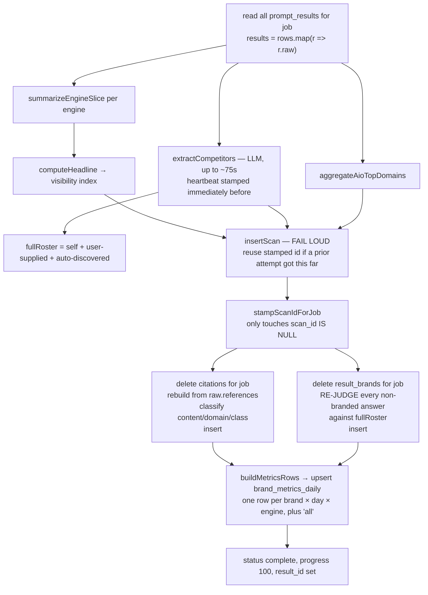
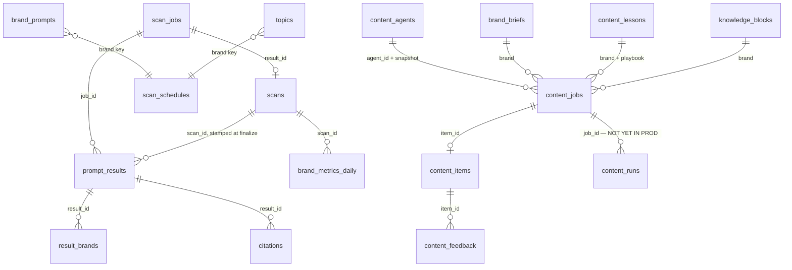
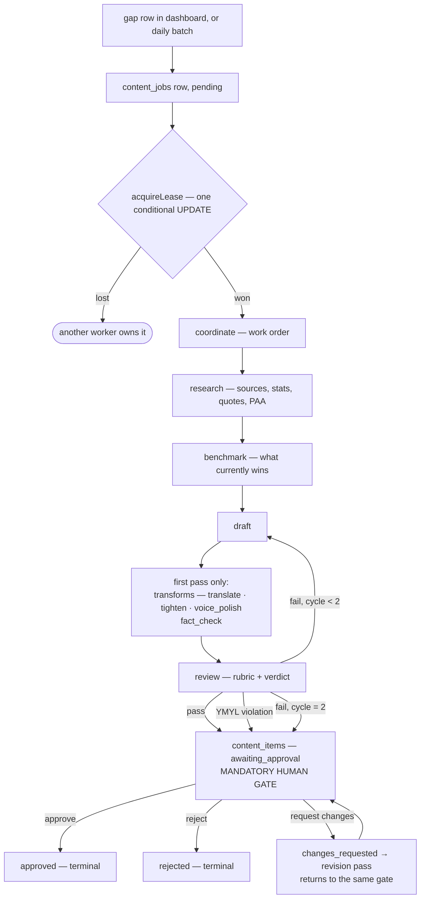
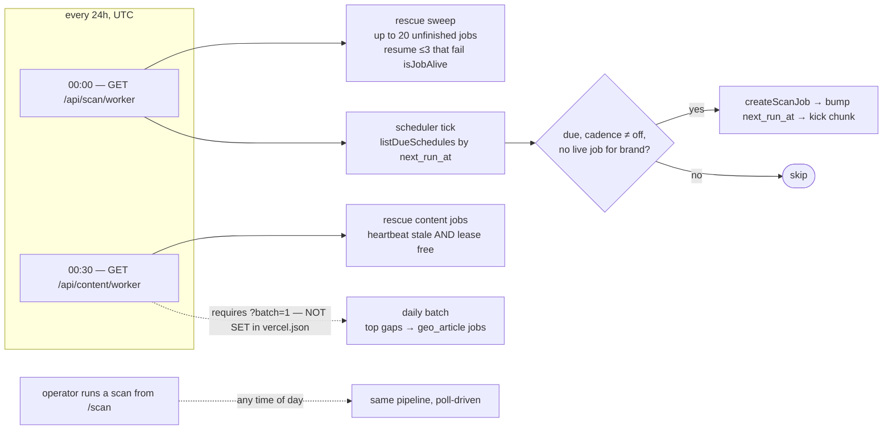

# Perceev — system overview

**What this is.** The technical map of the product as it exists in `main` @ `5111219`,
plus a reading of the live database taken 2026-08-31. Diagrams are Mermaid so they
render in GitHub and diff like code. The prose companion with hand-drawn figures is
published separately; this file is the source of truth.

**Contents**

1. [System map](#1-system-map)
2. [The scan lifecycle](#2-the-scan-lifecycle)
3. [The probe grid](#3-the-probe-grid)
4. [Scoring — the denominator chain](#4-scoring--the-denominator-chain)
5. [Finalize — one read, five writes](#5-finalize--one-read-five-writes)
6. [Data model](#6-data-model)
7. [Content OS](#7-content-os)
8. [The daily loop](#8-the-daily-loop)
9. [Live reading, 2026-08-31](#9-live-reading-2026-08-31)

---

## 1. System map

One Next.js 14 app on Vercel. No separate backend, no queue, no worker dyno — the
"worker" is an API route that re-enters itself. Postgres on Supabase is the only
durable state, and every long-running job is a row in it.

Engines are resolved from the `ENGINES` env var against a registry; an engine whose
key is missing is skipped with a warning, never faked. Production currently runs
`aio` and `perplexity`; `chatgpt` is dark for want of `OPENAI_API_KEY`.

---

## 2. The scan lifecycle

The one mechanism worth understanding. A scan is **not** a request that runs to
completion — it is a job row advanced by repeated, time-boxed *chunks*, any of which
may be killed mid-flight without losing work.

### Why it survives being killed

Three independent things can re-enter a stalled job. None of them is trusted alone:

| Path | Trigger | Cadence |
|---|---|---|
| Self-continue | chunk hit its 150s budget | immediate, best-effort |
| Poll rescue | `/status` sees a stale heartbeat | every 2s while a tab is open |
| Cron sweep | `/api/scan/worker` with no `job_id` | **once a day, 00:00 UTC** |

"Stale" is one definition in one place: `isJobAlive` — a running status *and* a
heartbeat inside `HEARTBEAT_STALE_MS` (180s). `updateScanJob` stamps the heartbeat on
every call, and probing calls it after **every batch**, so a genuinely working chunk
can never look dead. The same predicate stops a crashed job from blocking new scans
for its brand.

Single-flight is structural, not advisory: `claimJobStatus` is a conditional UPDATE
whose `WHERE` includes the expected current status, so of two racing callers exactly
one matches a row. That guard sits in front of sourcing (or two workers generate two
divergent prompt batches) and in front of finalize (or two workers write two `scans`
rows for one job).

---

## 3. The probe grid

A scan's unit of work is an **(engine, query) pair**, and the pair is the idempotency
key. `prompt_results` carries `UNIQUE (job_id, engine, query)`, so a resumed chunk
re-reads what landed and skips it.

Two deliberate choices are load-bearing:

- **`raw` stores the complete probe result**, so finalize can reconstruct the exact
  results array *and* materialize citations later from the same rows. Nothing about
  a probe needs re-fetching.
- **Citations are not written during probing.** "Pair completed" is defined solely by
  a `prompt_results` row; an instance dying between a results write and a citations
  write would skip the pair on resume and lose its citations forever. They are a
  finalize-derived artifact instead, rebuilt idempotently.

---

## 4. Scoring — the denominator chain

The score is not "mentions ÷ prompts". It is a chain of filters, and every step exists
because a naive denominator produced a misleading number in a real scan.

**Why the eliciting filter exists.** On a live tiles-brand scan, 40 of 56 answered
prompts were arithmetic, definitions and how-tos that named no vendor at all. Scoring
across them divided by impossibility and capped the achievable score at 16/56 before
the brand's real visibility was ever measured. **Why it is gated.** Competitors are
discovered at *finalize*, after probing — so during a live scan the roster holds only
the self brand, and "did this answer name any vendor" degenerates into "did it name
us", forcing 0/0 or a flattering 100%. The filter therefore applies only when a rival
actually appears in the slice.

Related: `share_of_voice_pct` is **null**, not 0 and not 100, without rivals — the
dashboard says "not available" rather than printing self ÷ self = 100%.

Two gates can suppress the number entirely rather than report it:

| Gate | Condition (aio) | Meaning |
|---|---|---|
| `data_source_issue` | error rate > 50%, or non-branded coverage < 15% | the feed is broken, not the brand |
| `insufficient_sample` | eliciting pool < 5 | too small a sample to claim anything |

Engine weights are relative and renormalized over whichever engines were eligible
(≥5 non-branded answers, no data-source issue), so aio + perplexity is a 50/50 blend
and a lone survivor is 100% of the index.

---

## 5. Finalize — one read, five writes

Finalize reads every persisted row once and fans out. Every write is idempotent,
because crash-recovery may run this phase more than once for one job.

The re-judge in `C2` is the fix for a real scoring bug: probe-time judging only ever
knew the *user-typed* competitor list, so a brand scanned with no competitors got a
self-only roster, `sov_pct` came out 100% by construction, and gap analysis — which
needs rival mentions in `result_brands` — was always empty. Finalize now recomputes
the whole matrix against the discovered roster.

---

## 6. Data model

19 tables live. `brand` columns in the analytics tables store `resolveBrandKey()`
output — a **domain-first key** — never the typed display name. Display names live on
`scans` / `scan_jobs`. Mixing the two is the most common way to query nothing.

| Group | Tables | Written by |
|---|---|---|
| Scan control | `scan_jobs`, `scan_schedules` | worker, scheduler tick |
| Prompt set | `brand_prompts`, `topics` | sourcing, additive only |
| Evidence | `prompt_results`, `result_brands`, `citations` | probing + finalize |
| Reporting | `scans`, `brand_metrics_daily` | finalize |
| Content OS | `content_jobs`, `content_items`, `content_runs`, `content_feedback`, `brand_briefs`, `content_lessons`, `content_agents`, `knowledge_blocks` | content worker + Studio |
| Lift | `content_events` | operator |

**Prompt-set contract.** Prompt sets are keyed by domain, frozen, and only ever
extended additively. A scan aborts loudly rather than silently regenerating prompts,
because scoring a different set of questions would quietly break comparability.
`prompt_set_id` (first 16 hex of a sha256 over the sorted unbranded set) rides on
every scan and every daily rollup so the UI can mark where a tracked set changed.

---

## 7. Content OS

A gap becomes a drafted asset through a composable block pipeline, behind a mandatory
human gate. Exclusivity here is a **durable lease**, not a status CAS, because a
content job passes through eight statuses and must be resumable in place.

Guardrails, all enforced in code:

- **Cost cap** — `CONTENT_MAX_COST_PER_ITEM` (default $0.15) checked after *every*
  block; a job that crosses it throws with the block named.
- **Bounded loop** — at most 2 draft→review cycles, then the item goes to the human
  queue flagged `below_threshold` regardless.
- **YMYL is never auto-revised** — a flagged violation routes straight to the human
  with the violation named.
- **Stage table validates itself** — `stages.js` asserts its own transition graph at
  module load, so a typo is a startup error rather than a silent wrong status.
- **Per-block ledger** — `content_runs` records cost and tokens per block per cycle,
  so "which block eats the $0.15" is answerable. *(Table not yet in production.)*

---

## 8. The daily loop

Two Vercel cron entries, both daily, both `CRON_SECRET`-gated.

Cadence per brand is `72h` (default), `daily`, `weekly` or `off`, stored on
`scan_schedules` and converted to `next_run_at` on each run. The schedule is bumped
**before** the fire-and-forget kick, so an instance dying mid-kick cannot leave a
schedule permanently "due" and pile up a job per tick.

Three properties of this loop are worth stating plainly:

1. **The cron is a floor, not the engine.** At daily cadence, a job abandoned with no
   browser open waits up to 24 hours for rescue. Poll-driven rescue is what actually
   recovers scans during working hours.
2. **The scheduler is the only thing that makes the product recurring.** With no rows
   in `scan_schedules`, the tick is a no-op and Perceev is an on-demand scanner.
3. **The content batch never fires from cron** as configured: `vercel.json` calls
   `/api/content/worker` with no `?batch=1`, and `CONTENT_DAILY_BATCH` defaults to 0.
   Two independent switches, both off.

---

## 9. Live reading, 2026-08-31

Taken from the production Supabase project. Numbers, not impressions.

| Reading | Value |
|---|---|
| Scans stored | 60, across 13 distinct brand strings |
| Scan jobs | 79 — 25 complete, 54 failed, 0 running |
| Most recent scan | **2026-07-30** — 32 days ago |
| Rows in `scan_schedules` | **0** |
| Prompt results | 1 070 — aio 828, perplexity 242 |
| aio answer coverage | 462 / 828 = 56% |
| perplexity answer coverage | 242 / 242 = 100% |
| Brand mentioned | aio 74, perplexity 37 |
| Citations | 6 631, **100% classified** — 0 unenriched |
| Result brands | 2 822 |
| Daily metric rows | 46 — `all` 20, `aio` 20, `perplexity` 6 |
| Content jobs / items | 4 / 2 |

### Job failures, by cause

| Cause | Count | Last seen |
|---|---|---|
| Marked failed by an `R0.1.11` reconcile on 2026-08-30 — jobs stranded in a running status | 43 | 2026-07-24 |
| `generateUnbrandedPrompts` produced too few unbranded prompts (OpenRouter) | 11 | 2026-07-24 |

The 43 are a **bookkeeping cleanup**, not 43 separate incidents: jobs orphaned before
the checkpointed worker landed, swept into `failed` by a later reconcile. The 11 are
real, and they share one root cause — the free utility model returning 3–4 usable
prompts against a target of 30, which the prompt-set contract correctly refuses to
paper over.

### Where the repo and production disagree

Both are facts about today, and both matter for reading anything above.

- **Migration 006 is not applied.** `content_runs` does not exist in the live
  database. The content worker's ledger writes are fail-soft, so the pipeline runs —
  it just records no per-block cost.
- **Production carries two tables this repo does not define:** `scan_rate_limits`
  (`bucket_key`, `window_start`, `hits`) and `system_heartbeats` (empty). Together
  with the `R0.1.11` reconcile stamp on those failed jobs, this says production is
  running a hardening branch that is not merged into this `main`.
- **`DESIGN.md` describes the dark "signal box" world; the shipped tokens in
  `src/app/globals.css` are light-first** — paper `#F7F7FA`, indigo `#3730CE`. The
  most recent commit ported a new design system; the design document has not caught up.

### The honest summary

Everything in sections 2–7 is built, tested and committed. What is *running* daily is
a rescue sweep over an empty active set and a scheduler tick over an empty schedule
table. The pipeline is sound and idle: to make the product recurring, the missing
piece is rows in `scan_schedules`, not code.
