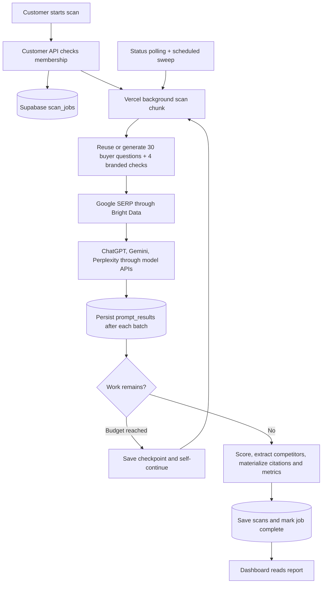

# Collection reliability incident — 15 October 2026

> <!-- doc-status -->
> **Status: LIVE.** Incident investigation, not a repaired-production claim. Production records inspected read-only; live provider checks used local credentials. No production configuration, customer records, or application behavior changed by this investigation.

## Finding

The report in the screenshot failed primarily because production's OpenRouter requests were rejected, not because the job exceeded a 300-second lifetime. Google AI Overview collection has a separate, reproducible Bright Data browser/session failure. More waiting or an email notification alone cannot repair either problem.

The previous PR fixed the rendering of unknown scores. It did not repair collection credentials or provider reliability. Passing the unit suite and build did not establish working production collection.

## Exact incident

- Workspace URL: `https://tracyourstory.xyz`; brand: `trace`.
- Scan: `699eda4b-dc9f-415a-9827-7618003ec086`.
- Job: `0a5e6fe0-8ff7-44bf-bf65-bc46cf66a3c3`.
- Started 14 October at 9:42:18 PM IST; finalized around 9:50:28 PM IST.
- Frozen country: India (`in`).
- 30 buyer questions plus four branded checks, across four engines: 136 question/engine pairs. This is why the report can say 34 errors alongside 30 buyer questions; the error counter includes the four branded checks.

| Engine | All pairs | Buyer answers | All errors | Recorded cause |
| --- | ---: | ---: | ---: | --- |
| Google AI Overviews | 34 | 18/30 | 13 | 11 “No ready cookies”; one provider function timeout; one aborted request |
| ChatGPT | 34 | 0/30 | 34 | OpenRouter HTTP 401, “User not found.” |
| Gemini | 34 | 0/30 | 34 | OpenRouter HTTP 401, “User not found.” |
| Perplexity | 34 | 0/30 | 34 | OpenRouter HTTP 401, “User not found.” |

There were 19 answers including branded checks, 115 error rows, and two successful Google responses without an Overview. The latter are legitimate observations; they must not be confused with provider failures.

The job crossed three invocations successfully:

| Invocation | Work | Elapsed | Attempted pairs | Answered pairs | Errors |
| --- | --- | ---: | ---: | ---: | ---: |
| 1 | Sourcing + Google probing | ~192 seconds | 12 | 4 | 8 |
| 2 | Google probing | ~184 seconds | 18 | 14 | 4 |
| 3 | Remaining Google + all text engines + finalization | ~111 seconds | 106 | 3 | 103 |

All three ledger rows closed normally. No invocation timeout or stale-run reap explains the missing text-engine answers in this incident. The third invocation made 102 rejected text-engine requests in about 26 seconds.

## Earlier incidents: account balance versus key limits

Production evidence shows different failures over time:

| Scan finalized, IST | Text-engine evidence |
| --- | --- |
| 13 October, ~11:31 PM | ChatGPT answered all 34; later Gemini/Perplexity requests exhausted a $1 per-key lifetime limit |
| 13 October, ~11:43 PM | All three text engines rejected requests under the exhausted $1 key cap |
| 14 October, ~12:18 AM | All three text engines answered all 34; Google still had 16 collection errors |
| 14 October, ~12:36 PM | ChatGPT answered eight, then a $4 key lifetime cap was exhausted; Gemini and Perplexity rejected all 34 each |
| 14 October, ~9:50 PM | All three text engines rejected all 34 each with HTTP 401 |

The provider explicitly identified `openrouter_key_limit`, with no reset, in the 403 responses. Available account funds do not imply that a particular API key has permission to spend them. The later 401 establishes a credential refusal but does not distinguish revocation, deletion, or an account-side problem. Those causes must not be guessed from this error alone.

Fresh competitor extraction also failed with the same gateway refusal. The latest report persisted `roster_source: carried_forward` and `roster_extraction_offline: true`: its competitor roster came from a prior successful extraction, not a successful new model call. The stored buyer questions concern technical-founder storytelling, LinkedIn writing, and turning work into social posts, matching the current Trace site's positioning. The earlier diagnostic demo-tool question was only a provider smoke test; the full replay uses the actual stored questions.

The locally configured OpenRouter credential authenticated successfully on 15 October and reported $10 of remaining key allowance before the live replay. Live ChatGPT, Gemini, and Perplexity requests worked with it. Production's secret is registered as sensitive and could not be read for comparison through the Vercel environment API. Production therefore needs its active deployment credential validated; this investigation does not claim the local and hosted keys are equal or that production has been repaired.

## Full local collection replay

The real `runProbingPhase` replayed the original 34 questions for each text engine, with its normal concurrency, per-batch writes and chunk checkpoints. All persistence was replaced with the existing memory backend; production credentials for database access were cleared before importing the worker. A $2.50 per-scan spend ceiling bounded the run.

| Engine | Answers collected | Collection errors | Unverified citation lists |
| --- | ---: | ---: | ---: |
| ChatGPT | 34/34 | 0 | 0 |
| Gemini | 34/34 | 0 | 3 |
| Perplexity | 34/34 | 0 | 0 |

The run persisted **102/102** pairs in **366.766 seconds (~6 minutes 7 seconds)**, with **$1.602235925** in gateway-recorded charges and two chunk budget handoffs. Gemini's three unverified citation lists remain a quality limitation; 100% answer collection does not mean 100% verified search evidence.

This replay deliberately bypassed sourcing and finalization, reusing the original pre-finalization competitor inputs (an empty configured roster). Its provisional scoring output is not a refreshed competitor benchmark and is not compared to the final customer scores. It also does not test the hosted credential, Google collection, or email delivery. It does establish that these exact questions can be collected by the real text worker with the current working local credential.

The compact [evidence JSON](2026-10-15-collection-evidence.json) records production counters/timings, replay counts/cost, and Google comparison outcomes without credentials, prompts, answers, or raw provider error bodies.

## What the backend actually does



1. `src/app/api/customer/scan/route.js` creates a durable job and starts work through `keepAlive` / Vercel `waitUntil`.
2. `src/lib/workers/scanWorker.js` sources questions, freezes the engine set and country on a checkpoint, then probes and finalizes. It has a 150-second soft chunk budget. Routes allow 300 seconds per invocation. A complete scan can span multiple invocations already.
3. Engines are processed **one after another** in `runProbingPhase`. Each engine has concurrency within its own batch: Google six, the text engines four. A struggling Google phase delays the start of otherwise healthy text engines.
4. `src/lib/scoring/enginePipeline.js` resolves adapters. Google uses Bright Data SERP; Gemini uses OpenRouter; ChatGPT and Perplexity prefer native credentials when configured and otherwise use the shared OpenRouter gateway. The recorded incident errors establish that the text engines used OpenRouter in this scan.
5. `src/lib/engines/openRouterProbe.js` allows 45 seconds per attempt and up to three attempts. HTTP 401/403 stop retries for that individual request, but do not stop subsequent questions or the other engines sharing the same credential.
6. `src/lib/db/analytics.js:getCompletedPairsForJob` treats **any saved row** as a completed pair, including an error row. Chunk resumes protect successful work from duplication but also skip failed work forever for that job.
7. Finalization computes engine health/measurement states, saves the report and materializes citations and metrics. `status: complete` describes execution reaching the end, even when most collection failed. The customer sees “Scan complete” and an overall score alongside a warning.
8. `src/components/portal/useScanTracker.js` polls every 2.5 seconds and can re-adopt a running job after reload. A stale job is rescuable after three minutes. The browser is already separate from persisted job state.

The source `vercel.json` specifies daily sweeps, but live scheduler ledger entries on 15 October were approximately ten minutes apart. A deployed/external trigger is active beyond what that file alone explains. Do not assume either daily-only recovery or a verified one-minute queue SLA. The trigger's configuration and owner still need to be reconciled.

There is also a separate long-lived `worker/` fleet, and production has a fresh idle fleet heartbeat. **That fleet is not the active model-API collection path.** `worker/src/lib/probe.js:probeBatch` still throws “no adapter is built yet.” Its existence and heartbeat do not establish a working consumer ChatGPT/Perplexity capture service. Routing jobs to that stub would not fix this incident.

## Google isolation tests

With the current local credentials and India target:

- A real four-engine diagnostic question returned answers from ChatGPT (~13 seconds), Gemini (~20 seconds), and Perplexity (~12 seconds).
- Google for the same diagnostic question failed after ~30 seconds with “No ready cookies.”
- A second Google query with AI Overview capture disabled succeeded in ~43 seconds and returned eight ordinary results.
- Enabling AI Overview capture on that query failed in ~50 seconds with the provider error `waiting for selector "#main" failed: timeout 30000ms exceeded`, even though the app allowed 90 seconds.
- On the same query with `gl=in`, `hl=en` and `brd_ai_overview=2`, omitting the separate `country: in` proxy-egress constraint returned a real Overview (2,404 characters) and eight organic results in ~38 seconds. This is a candidate egress/session-pool issue, not proof of a repaired Google collector. The market query parameters stayed India; the physical proxy location was no longer explicitly pinned. Repeated results and geographic validity must be checked before changing that measurement path.

The repeated comparison **did not validate removing the country constraint as a fix**. Two original stored questions were each tried with and without the egress pin: the first failed with “No ready cookies” in both modes; the second returned a real 2,507-character Overview with the India egress pin and failed without it. This is intermittent provider/session availability, not a proven bad country parameter. No production parameter was changed.

This isolates an upstream AI Overview browser/session problem, rather than a universally invalid Bright Data key or solely an app request deadline. It does not prove every India query is broken or identify the internal Bright Data defect. A small diagnostic sample is not a reliability benchmark.

The adapter already sends `brd_ai_overview=2`. Bright Data documents that this launches browser capture and adds latency. Its documented async SERP interface can return a durable response ID for later retrieval; it is a candidate to evaluate, not a proven cure for the cookie failures. Normal response times do not make a 20-minute guarantee safe: the provider documents possible much longer peak delays.

## Reliability gaps in our implementation

| Priority | Gap | Consequence | Required change |
| --- | --- | --- | --- |
| P0 | A present key is treated as a ready provider | Production `/api/health` returned `ok` despite the stored collection incidents | Authenticated deployment preflight and periodic provider canaries; persist last success/failure separately from liveness |
| P0 | No shared-credential circuit breaker | One rejected OpenRouter key becomes 102 error rows | Stop new gateway work on typed authentication/key-cap failures, preserve successful work, expose an actionable blocked state |
| P0 | Error rows are terminal for resume | Temporary failures survive as the final report | Persist per-pair state, attempts and `next_attempt_at`; retry transient failures within an explicit scan deadline; never reissue successful pairs |
| P0 | Execution completion is conflated with collection quality | 115 failed pairs still produce a “complete” scan | Separate lifecycle from `healthy`, `partial`, `blocked`, and `failed` collection quality; expose engines measured/expected beside the headline |
| P0 | Bright Data AIO/session failures remain unresolved | Google data is often missing even when text-engine auth works | Validate the India AIO zone/session capacity, test async collection, and benchmark a second real Google capture path if needed |
| P1 | Engines run serially | Google failures delay every later engine | Independent engine queues with bounded per-provider concurrency and shared spend/rate limits |
| P1 | Recovery trigger differs between source and observed production | Recovery latency depends on an undocumented scheduler | Make the actual durable runner/sweep deployment explicit and verify browser-closed recovery |
| P1 | Failure metadata is lost between adapters | Worker cannot reliably distinguish auth, cap, transport and query failures | Preserve HTTP status, provider, model, failure category, retryability and request ID through `probeTextEngine` and persistence |
| P1 | Cost accounting is incomplete on failed Google attempts | Failed calls can appear to cost zero although the provider may bill some attempts | Track provider request IDs and reconcile real charges; keep unmeasured cost distinct from measured zero |
| P1 | Some request deadlines end before response-body consumption | A stalled body can outlive the intended timeout | Keep cancellation active through parsing; carry the remaining chunk deadline into retries and finalization |

The last timeout point is a static code finding: Bright Data clears its abort timer immediately after receiving headers. It is **not** evidence that this specific scan died there. Likewise, raising a 45-second attempt timeout without changing the chunk budget can make the last batch and its retries exceed a 300-second invocation. A longer product turnaround needs durable scheduling, not just larger constants.

## Scoring and sample quality are separate from collection

The screenshot's 0% was a result from the surviving Google slice, not a successful four-engine measurement. Only three of its 18 buyer answers named a tracked brand. The score is therefore based on a very small eligible pool even before considering the other three missing engines.

A good collection run can still have few answers naming roster brands. That requires reviewing question intent and competitor extraction, not increasing network timeouts. Conversely, a provider error cannot count as an answer that omitted the brand. Google genuinely returning a SERP without an Overview is another distinct outcome.

Text-engine API measurements are not authenticated consumer-app captures. They must continue to be labeled accordingly; swapping a model-generated answer into a Google failure would fabricate the product's evidence.

## Proposed 15–20 minute / email workflow

The proposed asynchronous experience is appropriate. It should sit on top of reliable collection:

1. Accept the scan, return a durable job ID immediately, and show the expected turnaround as an estimate measured from real runs.
2. Use the signed-in member's verified email when they opt in; offer an email field and verification/consent for an anonymous scan. An arbitrary supplied email must not gain access to another workspace's report.
3. Schedule one durable unit of work per question/engine, recording provider request IDs for async providers, retry attempts, backoff and deadline. Keep one scan orchestrator responsible for completion decisions.
4. Continue text engines while Google is pending. Keep the dashboard readable with explicit per-engine pending/partial/blocked states. A provider being unavailable is not a 0% brand score.
5. Write a notification event to an outbox when report readiness changes. An email worker delivers an authenticated dashboard link with a deduplication key; a mail retry must not rerun collection or send duplicates.
6. At the scan deadline, either deliver a clearly partial report or say collection is blocked and explain the customer-facing next step. Notify again only if additional results materially complete it.

No report-mail integration is configured in the examined production environment-variable registrations. The existing authenticated dashboard is the natural report destination. Adding an email field alone would not create a background runner, retries, mail delivery, or a collection-quality gate.

## Repair sequence and release criteria

1. **Repair the active hosted gateway credential and allowance.** Verify it in the target deployment with an authenticated canary for every selected model. A locally passing probe is not a production acceptance test. Validate the new deployment before accepting customer scans.
2. **Add the blocked-state/circuit-breaker path and retryable pair lifecycle.** The 401, exhausted key-cap, transient Google session error, successful no-Overview result, and successful answer must all produce different actions. Test restarts and concurrent recovery to prove successful pairs are not charged twice.
3. **Resolve Google's collection route using live evidence.** Keep the India query set and measurement surface fixed while comparing request modes. Provider async mode is useful for long work, but only a repeated full-query test can establish that it improves collection success.
4. **Make the asynchronous runner and reporting contract explicit.** Independent engine scheduling, retry deadlines, collection quality, outbox and delivery status. The current consumer-capture fleet stub is not a shortcut.
5. **Run production acceptance:** the same 30 buyer questions plus branded checks, all selected text engines at least 90% answered, zero authentication/key-cap failures, every Google request either a valid observed SERP or an explicitly recorded provider failure, no fabricated answers, successful browser-closed continuation, and no duplicate collection or notification on resume. Google Overview appearance itself cannot be guaranteed; successful SERP observation is the collection criterion.
6. Repeat across enough runs to measure completion latency and provider error rates before advertising an average of 15–20 minutes. A single healthy query or a mock scan is insufficient.

## Reproduce the production evidence

```sh
node --env-file=.env.local scripts/audit-scan-collection.mjs \
  --scan-id 699eda4b-dc9f-415a-9827-7618003ec086
```

The added script opens a PostgreSQL **read-only transaction**, scopes every query to this scan, and outputs engine counts, normalized error categories, job timings and chunk counters. It makes no provider requests and prints neither credentials nor raw provider error bodies, answers or prompts. Database credentials stay in the ignored local environment.

Investigation artifacts under `/tmp` include the normalized production evidence and the isolated replay summary/answers. These are local diagnostic files, not new customer reports. The replay reuses the original stored questions and competitors and bypasses sourcing; it validates collection, not fresh prompt generation, hosted credentials, notification delivery, or consumer-app capture.

Verification of the investigation artifacts: the read-only audit script successfully reproduced the incident counters; its syntax check and invalid-ID refusal passed; the documentation guard passed 13/13 tests. No production deployment was performed.

## Primary provider references

- [OpenRouter errors: HTTP 401 means invalid credentials](https://github.com/OpenRouterTeam/docs/blob/main/api_reference/errors-and-debugging.mdx).
- [Bright Data Google query parameters and AI Overview browser capture](https://docs.brightdata.com/products/serp-api/query-parameters/google#ai-overview).
- [Bright Data asynchronous requests, response IDs, callbacks and retention](https://docs.brightdata.com/products/serp-api/asynchronous-requests).
