# Perceev: product, collection, scoring, and AI visibility audit

> <!-- doc-status -->
> **Status: HISTORICAL.** Snapshot of the 16 October 2026 audit; current repair status is tracked in the linked backlog and code.

**Audit date: 16 October 2026, Asia/Kolkata.**

**Verdict:** Perceev has useful engineering foundations, but its measurements are not dependable enough to support a promise that it improves clients' AI rankings. The immediate issue is successful answer collection, followed by metric correctness and a working measure → change → publish → observe loop. Adding more agents or generating more articles should follow those repairs.

You clarified that you have no clients yet. Existing scans and content are therefore treated as historical/test evidence, not as a representative client population or a basis for an uptime statistic.

## 1. What was inspected and what the evidence establishes

- Reviewed the production path from scan creation through prompt generation, engine adapters, checkpointed probing, persistence, finalization, scoring, analytics, dashboard normalization, content research, drafting, revision, approval, publication verification, and impact reporting. Also inspected customer authorization/RLS, GSC ingestion, scheduling, crawler checks, and deployment configuration.
- At the start of the audit, the supplied Google Drive workspace was incomplete: Git reported 834 staged files missing from the working tree, and many staged objects could not be read locally. I did not restore, reset, or overwrite that state. A fresh checkout of `Vismay299/aeovis` was used for inspection and isolated verification.
- **All 889 staged index entries match GitHub main**, with zero differences. The audited commit is `a2c97ddf12e332807c960e776eeae8de4550a210`. The latest GitHub production deployment record also points to that commit. This ties the source review to the supplied project and deployed version.
- Queried the production database using **read-only transactions**. Captured aggregate outcomes and selected scan metadata. No production records, credentials, schedules, billing settings, schema, or deployments were changed.
- Inspected the deployed landing page and sample report in the browser. The signed-in customer portal was not tested because there was no authenticated customer session in this audit.
- Read Profound and Peec's public product, methodology, help, and developer documentation. Their private implementation is unavailable; backend recommendations below are explicitly our design conclusions, not claims to have accessed their servers.
- Ran a clean dependency install in a separate verification checkout. **3,209 unit tests passed, 30 were skipped, zero failed.** An initial run using an older dependency directory and a shallow checkout had three environment failures; those were resolved and the complete suite rerun. Production build passed, with two existing React hook dependency warnings in `OpportunitiesPanel.jsx`.
- Existing offline acceptance completed **30 questions × 4 engines = 120 answers** through the real worker and scoring pipeline using isolated memory persistence. Separately, **11 adversarial cases reproduced** defects or misleading behavior. No paid live provider probes were made during this audit. Current provider recovery after the latest stored scan therefore remains unverified.

Evidence files in this folder: `production-evidence.json`, `production-details.json`, `site-evidence.json`, `adversarial-results.json`, `adversarial-reproductions.mjs`, `unit-tests-clean.log`, `build.log`, and `mock-acceptance.json`. The scripts are audit artifacts, not changes to application behavior.

## 2. Why the 30-question scan looks broken

The latest stored scan is `699eda4b-dc9f-415a-9827-7618003ec086`, for the test brand Trace. It finalized on **14 October 2026 at 9:50 PM IST**. Its job is marked `complete`.

The planned 30 unbranded questions were recorded for every engine:

| Engine | Unbranded question outcomes recorded | Answers/AIOs present | Collection errors | Valid no-AIO results |
|---|---:|---:|---:|---:|
| Google AI Overview | 30 | 18 | 12 | 0 |
| ChatGPT | 30 | 0 | 30 | 0 |
| Gemini | 30 | 0 | 30 | 0 |
| Perplexity | 30 | 0 | 30 | 0 |

There are also **four intentional branded checks per engine**. Across all 136 question/engine pairs, the scan recorded 19 AIOs/answers, 115 errors, and two valid Google results without an AIO.

This is different from never planning or attempting the 30 questions. In this scan, **the worklist exists; successful answers mostly do not**. An error row is evidence of an unsuccessful collection outcome, not a usable answer.

### Confirmed causes in stored production records

1. All 102 text-engine calls in the latest scan recorded **HTTP 401 credential rejection**. Eleven of the twelve unbranded Google errors were classified as **Bright Data cookie-pool unavailability**; the remaining unbranded error falls into the other-error category.
2. Earlier recent runs also contain **API key spending-limit failures**. Within the last 30 days of stored rows, the text-engine failures include 60 ChatGPT, 74 Gemini, and 102 Perplexity key-limit errors, alongside 34 credential-rejection errors for each. These are historical recorded outcomes, not a fresh validation of today's credentials.
3. The worker treats the existence of a persisted `(job, engine, question)` row as completion. The completion lookup does not distinguish an answered row from a retryable failed row. After adapter retries are exhausted, resuming the job skips that failed pair.
4. Finalization marks the job complete after processing the persisted outcomes, even if every outcome failed. A synthetic scan with **120 errors and zero answers** reproduced `status: complete`.
5. `/api/health` returned `status: ok` with configured vendors and a reachable database. Its implementation intentionally checks configuration/connectivity rather than successful provider answers. This health check cannot establish collection readiness.
6. Both stored recurring scan schedules are disabled. The scheduler's recent ledger says `no_schedules_due`. That is consistent with opt-in scheduling and having no clients, but means there is no active recurring baseline today.

Source: [completion lookup](https://github.com/Vismay299/aeovis/blob/a2c97ddf12e332807c960e776eeae8de4550a210/src/lib/db/analytics.js#L155), [probing phase](https://github.com/Vismay299/aeovis/blob/a2c97ddf12e332807c960e776eeae8de4550a210/src/lib/workers/scanWorker.js#L1636), [complete status](https://github.com/Vismay299/aeovis/blob/a2c97ddf12e332807c960e776eeae8de4550a210/src/lib/workers/scanWorker.js#L2655).

**Required repair:** distinguish workflow termination from collection quality. A scan should end with a clear outcome such as `complete`, `partial`, `blocked_configuration`, or `failed_collection`, backed by the full question/engine matrix. Stop scheduling further calls after a shared credential or budget failure. Retry transient failures through explicit attempt records, without retrying a permanently rejected credential 34 times.

## 3. Eleven things I could break without touching production

These are executable reproductions in `adversarial-reproductions.mjs`. They use synthetic data, memory persistence, and network stubs. The unchanged application passed its normal test suite while these behaviors still reproduced.

| ID | Reproduced behavior | Consequence | Priority |
|---|---|---|---|
| A01 | Thirty valid Google SERPs with no AIO and no transport errors become `failed / low_coverage`. | Legitimate AIO absence is confused with collection failure. | P1 |
| A02 | Thirty answers, only one eliciting a vendor, yield a **100% headline** even with `insufficient_sample: true`. | The adequacy warning does not gate the headline. | P0 |
| A03 | A brand cited without a textual brand mention is removed by the eliciting filter. The slice reports one citation but zero visible answers. | The implemented denominator conflicts with the advertised “mentioned OR cited” definition. | P1 |
| A04 | Adding an unmentioned rival to roster metadata changes the same answers from **20% to 100%**. | A score can change without any change in the brand's actual appearances. | P0 |
| A05 | “Avoid Acme. Rival is the best choice.” assigns Acme **position 1**; the simple sentiment window returns neutral for both. | First mention is presented as position, while negative presence can look like a recommendation. | P1 |
| A06 | Normalizing a sample strips `isSample`, defaults counted engines to zero, and retains its 43% score. | The sample banner/guards disappear and a contradictory report looks live. Browser inspection confirmed this. | P1 |
| A07 | All 120 question/engine pairs fail, yet the job becomes `complete`. | Workflow success is easily mistaken for a successful measurement. | P0 |
| A08 | Resuming probing after those 120 persisted failures performs **zero retries**. | A resumable job is not a recoverable measurement. | P0 |
| A09 | Current `visible`/`answer_present` rows cannot produce a value in the legacy `prompt_score` content-lift calculation. | The impact loop returns null instead of measuring the current engine data. | P1 |
| A10 | A final HTTP-200 SERP payload with an invalid shape is returned rather than raising a parse error. | Provider/parser failure can masquerade as no AIO. | P0 |
| A11 | The ChatGPT gateway wrapper drops model identity and web-search usage. | Provenance disappears before storage; an answer cannot be fully audited. | P1 |

The latest real Google slice demonstrates the practical scoring issue: it has 18 unbranded AIO answers, but only **three eliciting answers**, a 38.2% all-query error rate, `insufficient_sample: true`, and `state: measured_zero`. The headline eligibility checks answered count rather than sufficient size of the actual scoring denominator.

Sources: [eliciting filter](https://github.com/Vismay299/aeovis/blob/a2c97ddf12e332807c960e776eeae8de4550a210/src/lib/scoring/enginePipeline.js#L791), [sample flag](https://github.com/Vismay299/aeovis/blob/a2c97ddf12e332807c960e776eeae8de4550a210/src/lib/scoring/enginePipeline.js#L955), [headline eligibility](https://github.com/Vismay299/aeovis/blob/a2c97ddf12e332807c960e776eeae8de4550a210/src/lib/scoring/enginePipeline.js#L1052), [final malformed-response handling](https://github.com/Vismay299/aeovis/blob/a2c97ddf12e332807c960e776eeae8de4550a210/src/lib/engines/brightdata.js#L490), [sample normalization](https://github.com/Vismay299/aeovis/blob/a2c97ddf12e332807c960e776eeae8de4550a210/src/services/api.js#L612), [first-mention judging](https://github.com/Vismay299/aeovis/blob/a2c97ddf12e332807c960e776eeae8de4550a210/src/lib/scoring/judge.js#L298).

### Further issues established by source review

- **Geography is inconsistent across adapters.** Google accepts a frozen scan geography, while text adapters contain hardcoded India settings. The native Sonar branch omits the web-search tool and its location object. Requested geography should not be presented as verified execution location. Language, location, surface, and device belong on each run.
- **Search evidence is incomplete.** In the last five scans, all 170 rows per text engine lack persisted search-request telemetry; ChatGPT and Perplexity also lack model identity. None of the 680 recent rows carries screenshot evidence. A missing screenshot is expected for a model API, but incompatible with implying a browser capture.
- **Timeout coverage has gaps.** Bright Data clears the abort timer after response headers, before reading/parsing the body; zone discovery also uses an unbounded fetch. This is a source-level reliability concern, not a separately demonstrated production incident in this audit.
- **Answer-to-passage mapping is lost.** Bright Data's structured AIO blocks can carry reference indexes, but extraction flattens the text. Preserve the relationship between a claim, its supporting citation, and the original block.
- **First mention is not recommendation rank.** Retain it if useful, but name it `first_mention_order`. Measure recommended, compared, discouraged, and incidental appearances separately.
- **The legacy dashboard treats failed/denied reads as an empty account.** Its pinned-scan page converts non-OK responses into `scan: null`. An anonymous request for a tenant-owned scan was correctly denied; the UI then said “No report yet.” Respect the access restriction while showing an appropriate sign-in/error state.

## 4. What Profound and Peec do that matters

The table describes public vendor claims, not independently validated performance or private implementation details.

| Capability | Profound / Peec evidence | Perceev today | What to build or change |
|---|---|---|---|
| Consumer answer collection | Both describe collecting consumer web interfaces. | Google SERP collection plus text model APIs; `probeBatch` in the browser fleet throws “no adapter is built yet.” | Treat API research and consumer monitoring as distinct products/surfaces. Validate consumer collection before advertising it. |
| Repeated measurement | Both describe daily tracked runs. | Frozen question sets and checkpointing are useful; no enabled schedules in the inspected DB. | Scheduled repeated observations, explicit collection quality, surface/version change markers. |
| Prompt demand | Profound describes licensed, anonymized consumer panels and modeled volume estimates; Peec supports topic/context-based setup and discovery. | LLM generation, site text, PAA/autocomplete seeds; inspected GSC connections and rows are zero. | Label generated suggestions and demand proxies honestly. Do not invent AI prompt volumes. |
| Source intelligence | Public workflows connect prompts, sources, competitors, and actions. | Normalized citations, result brands, and gap analysis exist. | Validate whether the source page actually discusses the rival; distinguish citation, retrieval, and co-occurrence. |
| Page improvement | Both describe actions for improving existing content; Peec offers passage-level edits. | Studio can research and draft from winning pages. | Start with a diagnosed URL and a specific change, not automatically a new article. |
| Crawls and referrals | Profound describes verified server-log bot analytics; Peec documents log ingestion and GA4 AI referrals. | Robots checks exist; a connected crawler-log/referral outcome loop was not established. | Verified crawler fetches, landing-page referrals, and business conversions, with missing-attribution limits. |
| Business reporting | Both expose reporting/integration workflows. | Daily tables and dashboard exist, but lift uses a legacy score format. | Consistent metrics, change history, experiment cohorts, exportable evidence. |

Sources: [Profound collection methodology](https://www.tryprofound.com/features/answer-engine-insights), [Peec collection methodology](https://docs.peec.ai/intro-to-peec-ai), [Profound prompt demand](https://www.tryprofound.com/features/prompt-volumes), [Peec prompt setup](https://docs.peec.ai/setting-up-your-prompts), [Peec source analysis](https://docs.peec.ai/understanding-sources), [Peec page editing](https://docs.peec.ai/content-optimization), [Profound crawler analytics](https://www.tryprofound.com/features/agent-analytics), [Peec crawl logs](https://docs.peec.ai/crawl-insights), [Peec referrals](https://docs.peec.ai/ai-referrals).

**The design inference:** their useful advantage is a dependable observation → source diagnosis → action → outcome workflow. It is not evidence of a secret ranking endpoint. Their collection technology measures an AI surface; it does not itself make a client's website rank. Browser collection is also a controlled sample of a particular user/session/location, not an exact representation of every personalized response.

Profound's public API also exposes separate [answer](https://docs.tryprofound.com/rest-api/reports/query-answers-v2) and [fan-out](https://docs.tryprofound.com/rest-api/reports/query-fanouts-v2) reports. That supports separating data types in our model; it does not reveal their database, infrastructure, parser, or proprietary query-discovery method. Only store actual fan-out queries where observable; label generated research questions as hypotheses.

## 5. Keep the useful architecture; repair the data contract

Do not restart the application from zero. Preserve the checkpointed worker, incremental writes, normalized prompt/citation/brand tables, human approval gate, customer memberships, RLS, SSRF protection, and the distinction between null measurements and measured zeroes.

The inspected database has RLS enabled on the application tables and no broad unrestricted `anon` policies in the queried public-policy set. Old documents claiming there is no customer auth or that production still has unrestricted anonymous access are stale. This catalog check is not a substitute for signed-in cross-tenant read/write acceptance tests.

### Proposed collection architecture

```mermaid
flowchart LR
  A[Versioned question panel] --> B[Scheduled scan]
  B --> C[Question x surface x location x replicate]
  C --> D[Durable attempt queue]
  D --> E[Collector adapters]
  E --> F[Immutable response evidence]
  F --> G[Typed parser outcomes]
  G --> H[Collection quality gate]
  H --> I[Versioned metrics]
  I --> J[Source and page diagnosis]
  J --> K[Reviewed changes]
  K --> L[Publish and crawl evidence]
  L --> M[Repeated outcome measurement]
```

Implement this incrementally in the existing stack:

1. Freeze expected work **before execution**. Identify each logical run by tenant, prompt version, surface, country/city when applicable, language, device/session policy, scheduled date, and replicate. The current `(job_id, engine, query)` key has no replicate or per-question market dimension.
2. Keep a separate attempt history. Store typed failure kind, retry eligibility, attempt number, provider request ID, timing, estimated/observed spend, and next retry time. Keep the first failure even if a later attempt succeeds.
3. Separate `answered`, `no_aio`, `blocked`, `captcha`, `login_wall`, `timeout`, `parse_error`, `credential_rejected`, `budget_exhausted`, and `not_attempted`. Absence of an AIO is not a transport error.
4. Use a provider-level circuit breaker for credential/budget failures. A shared gateway problem should stop its dependent engines and request operator action, rather than create dozens of identical calls. Never change country or substitute a model answer silently to rescue an AIO run.
5. Preserve raw provider response evidence under a private retention policy. Consumer captures should include screenshot/DOM or equivalent permitted evidence. Store model identity, requested and observed location where available, search activation evidence, extractor version, and completeness state through every wrapper.
6. Add three operational views: infrastructure liveness, provider readiness/last successful canary, and recent collection quality. Keep paid probes out of ordinary health polling; run small scheduled readiness checks with explicit budgets.
7. Validate a Google collector against manual observations on a fixed India corpus across several days, including queries with and without AIOs. Compare latency, failure rate, citation completeness, location, and evidence. The code already sends `brd_ai_overview=2`; adding that parameter again is not a fix. Bright Data documents that it improves the chance of capturing an overview, not that every query must produce one. [Bright Data parameters](https://docs.brightdata.com/products/serp-api/query-parameters/google)
8. Evaluate a managed consumer collector against maintaining the browser fleet before committing to either. Select on measured India reliability and operating cost. The stub fleet is not nearly finished just because its queue and heartbeats work.

### Replace the headline's metric contract

Report the following separately, by surface and stable question panel:

| Metric | Definition |
|---|---|
| Collection completion | Valid terminal measurements / planned question runs. Valid no-AIO counts as a measurement; provider errors do not. |
| AIO trigger rate | SERPs with an AIO / valid SERPs. |
| Brand mention rate | Valid answers explicitly mentioning the resolved brand / valid answers in the chosen panel. Brand-free answers remain in this denominator. |
| Owned citation rate | Valid answers citing the client's verified domain / answers with observed citation data. |
| Positive recommendation rate | Answers positively recommending the brand / valid recommendation-intent answers in a panel classified before collection. |
| Conditional vendor share | Optional diagnostic among answers naming vendors. Label it as conditional and resolve entities independently of the selected tracked-rival list. |
| Share of voice | Explicitly defined brand appearances / all resolved brand appearances in the same measured panel. Publish the roster/parser version and denominator. |
| Business outcomes | Observed AI referrals, qualified leads, conversions, and applicable first-party Search Console metrics. |

Freeze panel membership by intent before looking at the answer. A low mention rate can be a real market result; it should not be corrected by removing the answers that named nobody. Preserve a separate informational panel where owned citations, rather than brand recommendations, may be the useful result.

Gate every headline on the **actual denominator**, collection completeness, and confidence. At 30 questions, one changed outcome moves a full-panel proportion by 3.3 percentage points; a denominator of three is much more unstable. Repeated observations help measure variation, but related questions are correlated and should not be treated as independent market samples. Cluster uncertainty by prompt/topic and show numerator, denominator, and collection window.

A cross-engine index is optional. If retained, freeze its engine cohort and justified weights, and suppress comparisons when surface, model, market, panel, or metric definitions change. A model-API index should not be compared directly with a consumer-browser index.

## 6. The content system needs evidence and outcomes

There is useful code here: research fetches top cited pages, benchmark passes consume scraped content, and generated items require human review. The problem is the quality and completeness of inputs and the absence of an evidenced ranking-improvement loop.

Confirmed gaps:

- `runResearch` may proceed with no scan answers or no successfully scraped winning pages; missing-source reasons are logged rather than becoming a durable research-quality gate. It explicitly allows compensation with general knowledge. For factual client content, require an approved first-party fact pack and claim-level supporting sources.
- A cited URL co-occurring with a rival in an answer is an **opportunity hypothesis**, not proof the publisher mentions or endorses that rival. Verify the page and quoted passage before recommending outreach.
- Automatic draft/review cycles run fact-checking only on the first cycle. Human-requested revisions run draft and review without a fresh fact-check. Every changed draft must invalidate and rerun its checks. [Revision implementation](https://github.com/Vismay299/aeovis/blob/a2c97ddf12e332807c960e776eeae8de4550a210/src/lib/content/contentWorker.js#L774)
- Coverage currently maps approved content to `covered`. That can describe editorial coverage, but cannot imply that a gap is fixed in search. Publication verification checks HTTP 200 and title matching, which does not prove indexing, crawler access, or citation.
- Publication status and its attribution event are not transactional. The publish route changes the item to `published` before recording the URL event; an event-write failure is logged and the route still returns publication success. Persist the URL and event atomically, or provide a durable reconciliation record, so published items cannot lose their outcome join.
- The learning step distills human editorial feedback. It is not yet learning from demonstrated ranking wins. Content lift reads a legacy `prompt_score` absent from the current engine rows.
- Production has 39 stored content items: 38 awaiting approval and one approved. No item is in a published state in this snapshot. The 64 failed content jobs are historical/test records; this audit did not establish their current causes or a client failure rate.

Use a workflow with distinct evidence:

**Diagnosed opportunity → approved brief → sourced draft → fact-checked revision → human approval → publication → index/crawl observation → subsequent citation/mention observation → traffic/conversion measurement.**

For each action, store the target URL, prompt cluster, original evidence, expected mechanism, owner, change timestamp/content hash, and evaluation window. Prefer updating a useful existing page when it already meets the intent. Create a new page only for a real distinct audience need. Do not create one thin page for every prompt variation.

## 7. How to improve clients' visibility on each platform

There is no dependable universal “rank #1 on AI” setting. Visibility depends on the question, market, platform, session, current retrieval, and the evidence available about the brand. Use measurements to select useful improvements, then test whether they worked.

### Google AI Overviews

Start with indexed, snippet-eligible pages, accessible Googlebot fetching, clear site structure, and original useful content. Audit the important URLs for HTTP status, robots rules, `noindex`, snippet restrictions, canonical selection, rendered/main text, internal links, and relevant structured data that matches the visible page. Current Google guidance also identifies the Search Console generative AI inclusion control as an eligibility requirement; include is the default, so verify the effective property/inherited setting rather than assuming an opt-in problem. [Google optimization guide](https://developers.google.com/search/docs/fundamentals/ai-optimization-guide), [inclusion control](https://support.google.com/webmasters/answer/16908024)

Prioritize product/service pages that answer actual buying questions with verifiable details: suitability, pricing where appropriate, constraints, comparisons, specifications, original tests, named expertise, and supporting images/video. Improve information quality and usefulness; formatting a generic answer into tiny “AI chunks” does not establish authority.

Google's current guidance rejects unnecessary AI text files and inauthentic mentions as ranking tactics. It also warns against mass-producing query-variant content. Treat competitor-cited pages as evidence of audience needs, not a template to copy at scale. [Google's current recommendations](https://developers.google.com/search/docs/fundamentals/ai-optimization-guide)

Connect Search Console and validate performance in its current Generative AI reports as well as broader search performance. Google says the dedicated insights were rolled out worldwide by 31 August 2026. The present code ingests conventional date/query search rows; this audit did not establish an API route for the newer dedicated reports. Support verified report export/manual comparison until the available API dimensions are checked. Do not claim the existing query table isolates AIO impressions. [Google report announcement](https://developers.google.com/search/blog/2026/06/gen-ai-performance-reports)

### ChatGPT

Make the important pages accessible to **OAI-SearchBot**, including applicable firewall access from published IP ranges. GPTBot is a separate training control; allowing training is not a prerequisite for search inclusion. ChatGPT-User is another distinct user-initiated fetcher. [Official OpenAI crawler guidance](https://developers.openai.com/api/docs/bots)

Build a consistent public entity: company/product names, categories, real capabilities, use cases, proof, and current facts across the owned site and credible independent sources. Seek accurate editorial coverage, real customer evidence, relevant directories/reviews, and useful community participation where those sources actually occur in the measured category. Avoid fabricated reviews, mass mentions, and attempts to instruct models to recommend the brand.

Measure representative consumer questions with context and constraints. The current generator explicitly favors 3–9 word search-bar queries. Those can be useful for Google, but should not be the entire ChatGPT panel. Keep engine-specific conversational panels and a common comparison panel. API tests remain useful for research, provided their surface and model are explicit.

### Perplexity

Verify **PerplexityBot** access and applicable firewall rules using the published crawler IP sources. Distinguish its index crawler from Perplexity-User. [Official Perplexity crawler guidance](https://docs.perplexity.ai/docs/resources/perplexity-crawlers)

Investigate repeatedly cited pages and their actual supporting passages. Find what makes them useful for that buyer decision: original research, current specifications, clear comparisons, primary evidence, or expert explanation. Improve the client's relevant page or pursue a legitimate correction/contribution on a repeatedly cited external source. Frequency of citation is an opportunity signal, not proof that obtaining a mention guarantees inclusion.

Validate consumer Perplexity collection separately from Sonar API collection. Preserve citations and, where actually observable, query/retrieval evidence. Unknown retrieval activity should remain unknown.

### A practical client service

Choose a narrow initial audience and market. For each first client:

1. Confirm business goals, products, geography, buyer personas, owned domains, real competitors, and verified company facts.
2. Create a reviewed panel covering discovery, evaluation, alternatives, use cases, and relevant informational needs. Save the origin of each prompt: interview/support/sales evidence, conventional search data, generated suggestion, or licensed panel data. Do not label SEO demand as AI demand.
3. Establish a stable repeated baseline with collection quality and platform-specific denominators. Use 30 questions as an initial diagnostic panel, not proof of market-wide share.
4. Choose a small set of changes with a mechanism and target page: technical repair, stronger product evidence, original research, existing-page improvement, or a legitimate external source opportunity.
5. Publish only reviewed work, record the change, and observe crawl/indexing and downstream results. Compare with untreated prompt/page clusters where practical. Report association and limitations; a simple before/after lift is not causal proof.
6. Report useful business outcomes alongside visibility. Referral counts miss some unattributed AI journeys, so describe them as observed traffic rather than the whole influence of AI.

## 8. How Perceev itself should rank and acquire credibility

The same standards apply to Perceev. Live checks found `perceev.xyz` returns 200, while its `/robots.txt` and `/sitemap.xml` return 404. The Vercel hostname also lacks those files, and the checked home HTML has no canonical link. A missing robots file does not itself block indexing, and a sitemap is not a ranking guarantee; these are technical clarity/discovery improvements.

Recommended owned-site work:

- Establish the preferred public hostname, canonical policy, sitemap, and appropriate indexing rules for product pages versus portal/account pages.
- Publish an accurate methodology: consumer versus API surfaces, sampling, location, scoring denominators, uncertainty, and failure handling. Replace the landing page's implication that every generated question is something buyers have actually typed unless there is evidence of that origin.
- Fix sample labeling and use the same 30 questions across every sample engine. The present 8/8/7/7 sample does not demonstrate the real cross-engine worklist.
- Publish specific product/use-case pages for a chosen initial market, plus transparent, substantiated comparison pages. A broad home page alone supplies little evidence for detailed buyer questions.
- Create a documented study using your own site or another site you are authorized to change. Publish methodology, failures, denominators, and measured results. Do not manufacture client case studies or imply historical test scans are customers.
- Add original findings: for example, differences between India AIO trigger rate and collection success, with reproducible prompts and limitations. This is more useful evidence than a large library of generic “what is AEO” articles.
- Lead the product with a result the buyer can verify: reliable monitoring, the specific source/page to improve, and a record of what changed. The agent canvas can support that workflow without being the primary promise.

## 9. What to do first

**First: recover collection and make failures actionable.** Resolve the deployed credential/budget failures, validate fresh canaries, diagnose India Bright Data failures with preserved request evidence, add retryable attempt state and circuit breakers, and make partial/failed scans explicit. Re-run a full 30-question scan only after the provider checks succeed.

**Second: repair the metric contract.** Fix A01–A05, A10–A11 and sample provenance. Publish numerator/denominator/quality on every report, gate insufficient samples, calibrate the actual production judge, and version the changed definitions. The existing calibration script uses the legacy `judgeDeterministic`, not the production `judgeBrandsSymmetric` path.

**Third: establish continuous measurement.** Activate an intentional schedule for an authorized test brand, finish or integrate reliable consumer collection, verify location/surface evidence, and prove jobs finish when no browser tab is polling.

**Fourth: make the source-to-action workflow effective.** Connect first-party data for the first real client or owned site, inspect important URLs, create page-level tasks with evidence, and require fresh fact checks on revisions.

**Fifth: demonstrate outcomes before expanding.** Run controlled improvements on an authorized site and record publish/crawl/citation/business outcomes. Expand engines, shopping, integrations, and agency features after the core measurement loop is trustworthy.

The detailed implementation tickets and acceptance gates are in `REPAIR-BACKLOG.md`. These are proposed product decisions, not changes deployed by this audit.

## 10. Limits and unresolved validation

This audit does not establish a current live provider pass rate, successful authenticated customer end-to-end UAT, multi-day consumer collection reliability, validated production judge accuracy, or an actual client ranking improvement. The 30 skipped tests are not passes. A build, mocked acceptance, a green health endpoint, and a heartbeat do not establish these outcomes.

No private Profound/Peec backend code or authenticated paid product was accessed. Their public documentation informs the comparison; it cannot establish their internal implementation or guarantee their marketing claims. No destructive test, production mutation, content publication, or billing change was performed.
