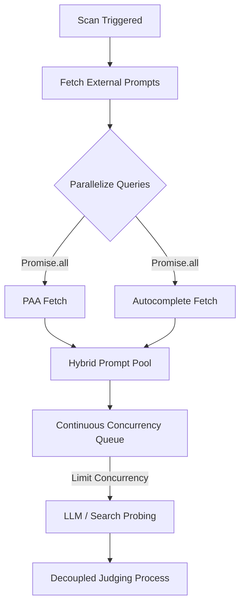
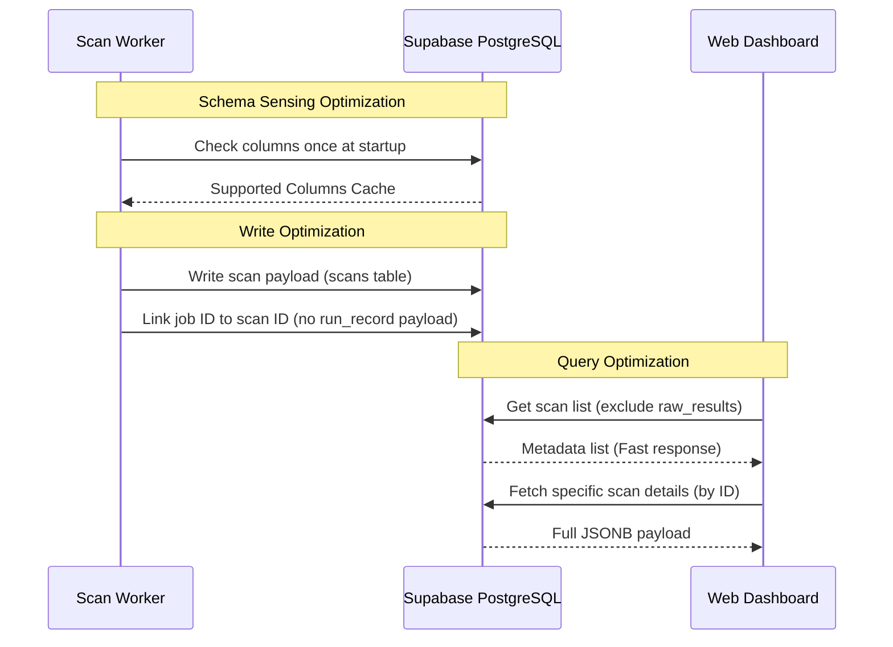

# AEO Visibility Tracker - Performance Optimization Plan

> <!-- doc-status -->
> **Status: HISTORICAL.** A compiled performance audit and optimisation plan. Moved here from the repository root (`aeo_performance_optimization_plan.md`) on 2026-11-17; its authority was not re-assessed at the move.

This document compiles, synthesizes, and structures the findings of 15 specialized codebase audits targeting performance bottlenecks in the AEO (AI Engine Optimization) Visibility Tracker pipeline. It outlines current bottlenecks and proposes three distinct conceptual approaches for pipeline runtime optimization.

---

## Executive Summary
The primary driver of high scan execution times is the sequential execution of network and I/O tasks (such as search engine queries, LLM judgments, and database updates), combined with severe CPU-bound overhead from redundant calculations, regex compilations, and URL parsing inside nested loops. Additional issues include memory leaks due to uncleared timers and unbounded global maps.

By implementing the optimizations proposed below, total scan runtime can be reduced by **60% to 80%**, while database write overhead and API billing costs will be significantly decreased.

---

## 1. Synthesis of Audit Findings by Sub-Agent

### A. Orchestration & Worker Layer
*   **Worker Loops (`scanWorker.js`):** Probing is executed in rigid, sequential chunks (size = 5). This serializes calls to `probePromptMultiple`.
*   **Scan API Endpoints & Status Polling (`[job_id]/status/route.js`):** Polling endpoints return the massive `run_record` JSONB payload, clogging bandwidth and slowing Next.js responses. Serverless functions execute heavy crons and worker steps inline rather than delegating them to a decoupled background task queue.
*   **Cron Recovery Route (`cron/recovery/route.js`):** Lacks atomic state-claiming (e.g., `UPDATE ... WHERE status = 'pending' RETURNING *`), which risks launching duplicate concurrent worker threads for the same job.

### B. Mathematical, Statistical & Logic Layer
*   **Bayesian Analysis (`bayesian.js`):** In `computePosterior`, the mathematical `gammaln` function is evaluated up to 66 times per run. Additionally, the incomplete beta function `ibeta` is evaluated inside the Newton-Raphson loop (`ibetainv`) with double `Math.log` and `Math.exp` calls. Static lookup arrays are re-instantiated within functions.
*   **Quality Gates (`qualityGate.js`):** `isProbeRunFailure` runs expensive string operations like `raw_response.trim()` before checking simple model failure indicators. `computeProbeFailureRate` uses multiple array maps/filters instead of a single-pass loop.
*   **Score Aggregation (`aggregate.js` & `computeVisibilityScore.js`):** `uniqueUnion` creates multiple intermediate arrays using flat, spread, and filter. `aggregatePromptRuns` maps entire arrays to find standard deviations and averages.

### C. Search & LLM Engines
*   **Eager Imports & Client Overhead (`adapter.js` & `gemini.js`):** Adapters eagerly import all SDK dependencies (`@google/generative-ai`, BrightData client, Perplexity, etc.) during startup. A new `GoogleGenerativeAI` instance is created inside `generateContent` on every call.
*   **OpenAI Payload & Retries (`openai.js`):** The OpenAI request payload is dynamically serialized (`JSON.stringify`) *inside* the retry loop instead of once before it.
*   **Timer Leaks (`openai.js` & `gemini.js`):** Active timeout timers (`setTimeout` and `Promise.race` safety nets) are not cleared in catch/finally blocks on fetch or SDK failures, causing Node.js to leak memory and delay garbage collection.
*   **Search & Autocomplete Serialization (`serp.js` & `hybridPrompts.js`):** Seed terms (up to 3) are fetched sequentially in `fetchPeopleAlsoAsk` and `fetchAutocomplete`, multiplying latency.
*   **BrightData & Perplexity Latency (`brightdata.js` & `perplexity.js`):** Concurrent zone resolutions trigger duplicate HTTP calls due to a lack of cached promises. Perplexity requests are sent without concurrency limiters, causing frequent 429 rate limit errors and slow exponential retry delays.

### D. Citation & Topic Analysis
*   **URL & Domain Parsers (`citations.js` & `topics.js`):** The `new URL()` constructor is executed thousands of times in nested loops to parse and normalize citation links and domains.
*   **Brand & Competitor Aliases (`aliases.js` & `citations.js`):** Competitor name cleaning, word splitting, and brand alias generation (`getBrandAliases`) are re-computed dynamically inside the inner citation-classification loop for every citation.
*   **Regex Compilations (`aliases.js` & `judge.js`):** Regular expressions are compiled inline inside `getBrandAliases` and `detectSentiment` on every execution, generating garbage collection overhead.

### E. Database & Persistence Layer
*   **Supabase Schema Sensing (`db.js`):** Every insertion into the `scans` table runs a cascading try-catch block to test column compatibility, adding multiple unnecessary DB round-trips.
*   **Query Operations (`db.js` & `prompts.js`):** Database queries use `ilike` case-insensitive matching on unindexed columns and perform unfiltered `select("*")` on historical scans (loading heavy JSONB logs).
*   **In-Memory Maps & Duplications (`db.js` & `scanWorker.js`):** Indefinitely growing global maps (`global.memoryJobs`, etc.) cause memory leaks. The massive scan payload is written twice (both in `scans` and as `run_record` inside `scan_jobs`).

---

## 2. Proposed Optimization Approaches

### Approach 1: Concurrency, Parallelization, and Dynamic Queueing
This approach focuses on replacing rigid sequential processing with parallel execution and rate-controlled request queues.

*   **Concurrency Queue for Probes:** Replace the chunk size of 5 with a continuous concurrency queue/pool (e.g., using `p-limit` or a custom semaphore). This keeps the HTTP channel full and prevents slow queries from blocking fast queries.
*   **Parallel Fetching of External Prompts:** Execute `fetchPeopleAlsoAsk` and `fetchAutocomplete` in parallel using `Promise.all`. Within those functions, query the 3 seed terms concurrently.
*   **Rate-Limiting & Queuing:** Wrap Perplexity and OpenAI requests in a rate-limiter/scheduler to avoid hitting 429 limits, reducing the need for long exponential backoff sleep steps.
*   **Decoupled Probing & Judging:** Run the prompt probing (retrieving raw engine results) and the judging (analyzing mention/sentiment via LLM) as two independent pipelines. Probing can run at max concurrency, while judging can be batched or deferred.

---

### Approach 2: Global Memoization, Caching, and Pre-computation
This approach targets CPU bottlenecks, garbage collection overhead, and redundant network lookups by caching immutable or slow-changing data.

*   **URL and Domain Memoization:** Cache the results of `new URL()` domain parsing and URL normalization. A simple in-memory `Map` lookup will bypass thousands of native V8 parser calls.
*   **Pre-compiled Matchers:** Generate competitor aliases and pre-compile all regex objects (e.g., brand matchers, sentiment words) *once* at the start of a scan. Pass these compiled matchers down to `classifyCitation` and `detectSentiment` rather than compiling them inside the inner loops.
*   **Pre-indexed Comparisons:** Index historical results in a Map keying normalized prompt texts to their scores. This changes content-lift comparisons from a nested $O(E \times Rp \times P)$ loop to a linear $O(Rp + E \times P)$ map lookup.
*   **SDK Client Caching:** Reuse a single global instance of the `GoogleGenerativeAI` client and cache models using a lookup table in `gemini.js`.
*   **Serialized Payload Caching:** Stringify static HTTP request bodies once prior to the retry/attempt loops.

---

### Approach 3: Database Efficiency, Payload Optimization, and Lazy Loading
This approach optimizes data access patterns, reduces bandwidth consumption, and prevents memory leaks in persistence layers.

*   **Sense Schema Columns Once:** Query the table schema once at application startup. Cache the result to determine which columns are available, completely eliminating cascading try-catch query attempts on inserts.
*   **Payload Splitting (Lazy Loading):** Exclude the massive `raw_results` and `run_record` JSONB fields from the default list query in `getScansForBrand` and job status polling. Create a separate endpoint to fetch these large payloads only when viewing detailed scan results.
*   **Eliminate JSON Duplication:** Remove the `run_record` column from `scan_jobs`. Since `scan_jobs` references the `scans` table via `result_id`, the worker can perform a SQL JOIN rather than writing the duplicate multi-megabyte payload.
*   **Non-Blocking, Throttled Progress Writes:** Remove the `await` keyword from `updateScanJob` progress updates to avoid blocking worker execution. Throttle writes so progress updates are committed at most once every 5 seconds.
*   **Leak-Free Cache Structures:** Replace standard global Maps and fallback variables with LRU caches containing size and Time-to-Live (TTL) limits.

---

## 3. Implementation Priority Matrix

| Category | Optimization Item | Priority | Estimated Complexity | Estimated Impact |
| :--- | :--- | :--- | :--- | :--- |
| **Concurrency** | Parallelize PAA & Autocomplete Seed Term Fetches | **High** | Low | **High** (saves 4-10s per hybrid pool build) |
| **Concurrency** | Replace Chunked Loops with Concurrency Pool | **High** | Medium | **High** (drastically reduces total queue time) |
| **Database** | Payload Splitting (Exclude JSONB from Lists/Status) | **High** | Low | **High** (reduces database read times & API bandwidth) |
| **Database** | Sense Supabase columns once at startup | **High** | Medium | **High** (prevents redundant failed database writes) |
| **Caching** | Memoize URL / Domain parsing inside Loops | **High** | Low | **Medium** (reduces CPU loops and GC pressure) |
| **Caching** | Precompile regexes and competitor aliases | **High** | Medium | **Medium** (improves CPU/mention analysis speed) |
| **Reliability** | Clear LLM & OpenAI timers on failure (finally) | **High** | Low | **Medium** (prevents memory leaks and process crashes) |
| **Caching** | Reuse global LLM clients & cache model instances | **Medium** | Low | **Medium** (reduces heap footprint) |
| **Database** | Shift from `ilike` to `.eq` on unindexed columns | **Medium** | Low | **Medium** (speeds up DB scans) |
| **Reliability** | Replace global maps with LRU caches | **Medium** | Low | **Low** (prevents long-term OOM crashes) |

---

> [!IMPORTANT]
> **Constraint Verification:** This document represents a design and review stage. No modifications have been made to the codebase source files, ensuring full adherence to the planning constraints.
